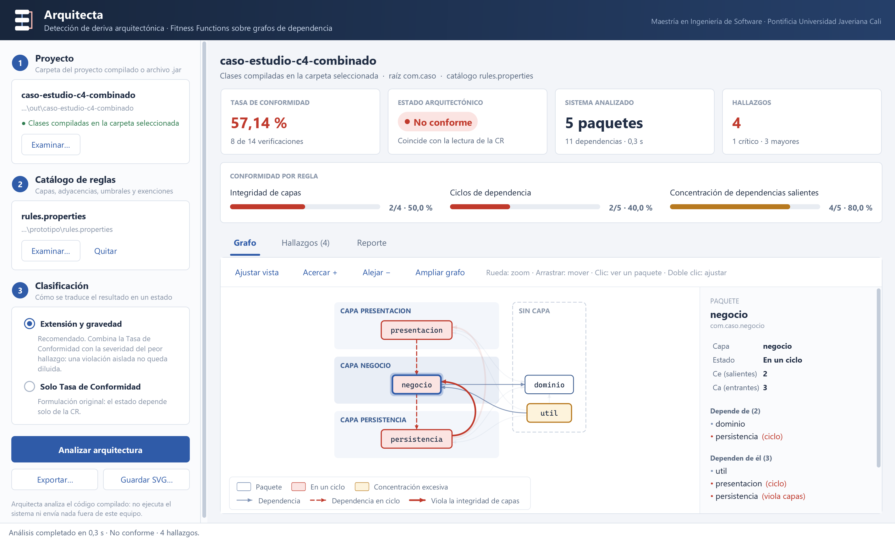
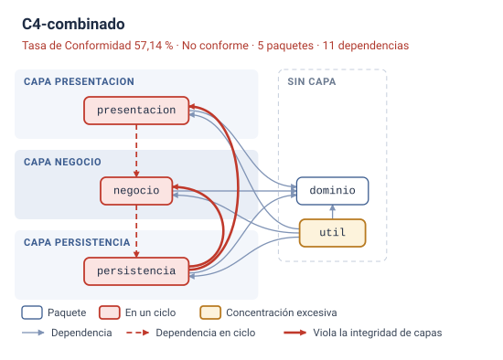

# Detección automática de deriva arquitectónica

**Un enfoque de gobernanza continua para PyMES de software, basado en *Fitness
Functions* y análisis estático de grafos de dependencia.**

[](LICENSE)
[](LICENSE-CODE)
[](https://adoptium.net/)
[](prototipo/src/test/java)

Trabajo de grado para optar al título de **Magíster en Ingeniería de Software**
de la Pontificia Universidad Javeriana Cali.

| | |
| --- | --- |
| **Autor** | Juan José Medicis Zambrano |
| **Director** | MsC. Juan Camilo Parra Martínez |
| **Programa** | Maestría en Ingeniería de Software |
| **Institución** | Pontificia Universidad Javeriana, Cali, Colombia |
| **Año** | 2026 |

---

## El problema

La arquitectura de un sistema se deteriora en silencio. Una dependencia que cruza
una capa, un atajo entre módulos, una clase que acumula responsabilidades: cada
concesión parece inofensiva por separado, pero juntas van apartando el código de
la estructura que se había previsto. A eso se le llama **deriva arquitectónica**,
y su factura se paga en costo de mantenimiento.

El problema se agrava en las PyMES de software, que rara vez conservan
documentación arquitectónica actualizada y no pueden costear plataformas de
verificación sofisticadas. Se produce entonces una paradoja: justo donde la
gobernanza técnica sería más rentable es donde menos se practica.

## La propuesta

Un mecanismo que infiere la estructura real del sistema **directamente del código
compilado**, sin depender de ninguna documentación, y la contrasta contra reglas
declaradas. Funciona en tres pasos:

1. **Extracción** — construye un grafo dirigido de dependencias entre paquetes a
   partir del *bytecode*.
2. **Verificación** — ejecuta tres *Fitness Functions* sobre ese grafo:
   integridad de capas, ausencia de ciclos y control de la concentración de
   dependencias salientes.
3. **Clasificación** — agrega los resultados en una **Tasa de Conformidad (CR)** y
   emite un veredicto: *aceptable*, *en observación* o *no conforme*.

Cada hallazgo llega acompañado de la evidencia que lo origina, hasta el método y
la línea de código concretos, y todo reporte declara explícitamente qué reglas se
aplicaron y qué quedó fuera del diagnóstico.

## Así se ve



Basta con abrir la aplicación (`arquitecta.bat` o `./arquitecta.sh`), elegir la
carpeta del proyecto —se reconocen Maven, Gradle, IntelliJ IDEA y Eclipse, o
directamente un `.jar`— y pulsar **Analizar**. La ventana muestra la Tasa de
Conformidad con su tendencia, el estado, la conformidad por regla, el grafo
interactivo (al seleccionar un paquete se atenúa todo lo que no le concierne) y
cada hallazgo con la evidencia que lo sustenta.



La herramienta dibuja el grafo que extrae, ordenado según la estratificación
declarada y con los hallazgos resaltados: en rojo las dependencias que violan las
capas y los paquetes atrapados en un ciclo, en ámbar el que concentra
dependencias. El SVG se abre en cualquier navegador sin instalar nada, y las
figuras de grafos de la monografía las genera la propia herramienta en TikZ.

## Resultados

El mecanismo se evaluó sobre cinco versiones de un mismo sistema: una
implementación de referencia y cuatro con derivas inducidas, tres de ellas
**aisladas** para poder medir la sensibilidad de cada regla por separado.

| Escenario | Paquetes | Dependencias | Verificaciones | Incumpl. | CR | Estado |
| --- | ---: | ---: | ---: | ---: | ---: | --- |
| C0 · línea base | 4 | 5 | 10 | 0 | 100,00 % | Aceptable |
| C1 · ruptura de capas | 4 | 6 | 11 | 1 | 90,91 % | En observación |
| C2 · ciclo de dependencia | 5 | 8 | 12 | 2 | 83,33 % | No conforme |
| C3 · concentración excesiva | 5 | 9 | 12 | 1 | 91,67 % | En observación |
| C4 · las tres combinadas | 5 | 11 | 14 | 6 | 57,14 % | No conforme |

Se detectaron **las seis derivas inducidas** sin producir un solo hallazgo falso
sobre la implementación de referencia.

### El hallazgo que hizo interesante el trabajo

Los escenarios de deriva aislada revelaron algo que un único caso alterado habría
ocultado: **la Tasa de Conformidad detecta la violación pero no siempre la
clasifica**. En C1 y C3 el mecanismo señaló correctamente la desviación, pero la
métrica se mantuvo por encima del umbral del 85 % y el sistema quedaba etiquetado
como *aceptable* pese a contener una violación real.

No es un defecto de implementación sino una consecuencia matemática: al ser una
proporción no ponderada, la CR mide la **extensión** del deterioro y es ciega a su
**gravedad**, y el efecto se agrava conforme crece el sistema.

La respuesta fue añadir un segundo criterio —la severidad del peor hallazgo—
adoptando siempre el veredicto más restrictivo. Es configurable, **no altera el
cálculo de la CR** ni sus umbrales, y con él los cinco escenarios se clasifican
como corresponde. La columna «Estado» de la tabla anterior ya refleja ese
criterio refinado.

### Sobre sistemas reales, en entorno controlado

Se inyectaron derivas conocidas en cuatro bibliotecas Java reales (Commons Lang,
Jackson Databind, ArchUnit y Guava, de 403 a 2 017 clases): el mecanismo detectó
**las 22**, sin un solo hallazgo espurio y en menos de un segundo por sistema, y
confirmó fuera del caso de estudio que la CR sola se diluye en sistemas grandes.

### El mecanismo aplicado sobre sí mismo

El prototipo se analiza a sí mismo: 9 paquetes, 26 dependencias, 40
verificaciones, **0 incumplimientos**, interfaz gráfica y asistente incluidos. La arquitectura interna satisface las
mismas reglas que el instrumento exige a los sistemas que evalúa.

---

## Estructura del repositorio

```
├── Maestria_PlantillaProyectoGrado/   Documento del trabajo de grado (LaTeX)
│   ├── main.tex                       Raíz del documento
│   ├── main.pdf                       PDF compilado (103 páginas)
│   ├── src/                           Capítulos y anexo
│   ├── referencias.bib                Bibliografía (39 entradas)
│   ├── compilar.bat / .sh             Compilación vía Docker
│   └── thesis.cls, format.tex, img/   Plantilla institucional (ver TERCEROS.md)
│
└── prototipo/                         Arquitecta: el mecanismo construido
    ├── arquitecta.bat · .sh           Punto de entrada único (doble clic: la aplicación)
    ├── src/main/java/                 Núcleo (config, grafo, reglas, motor, reporte),
    │                                  servicio de análisis e interfaz gráfica
    ├── src/test/java/                 Batería de 262 comprobaciones
    ├── caso-estudio/                  Los cinco escenarios (c0-base … c4-combinado)
    │                                  y su catálogo de reglas
    ├── ejemplos/                      Autoanálisis, ArchUnit, grafos SVG y capturas
    ├── lib/                           ArchUnit y SLF4J (ver TERCEROS.md)
    └── scripts/                       Guiones que invoca el lanzador
```

El **anteproyecto aprobado** se mantiene en un repositorio aparte; este contiene
únicamente el trabajo de grado y su artefacto.

---

## Compilar el documento

Requiere únicamente **Docker**: los guiones descargan por sí solos la imagen de
TeX Live, de modo que no hace falta instalar una distribución LaTeX.

```bash
cd Maestria_PlantillaProyectoGrado
./compilar.sh          # en Windows: compilar.bat
```

La secuencia es `pdflatex → bibtex → pdflatex ×2`. Conviene recordar que este
documento usa **`natbib` con `bibtex`**, no `biblatex` con `biber`; ejecutar
`biber` produciría una bibliografía vacía. El resultado es `main.pdf`.

## Ejecutar el prototipo

Requiere únicamente **JDK 17 o superior**: las dependencias están en `lib/`, sin
Maven, red ni repositorio local.

En Windows basta con **doble clic en `prototipo/arquitecta.bat`**: la primera vez
compila todo y abre la aplicación, cuya pantalla de inicio analiza cada escenario
del caso de estudio con un clic. El mismo lanzador reúne el resto de las tareas:

```bash
cd prototipo
./arquitecta.sh               # abre la aplicación (compila solo si hace falta)
./arquitecta.sh pruebas       # 262 comprobaciones
./arquitecta.sh experimento   # experimento completo; evidencia en resultados/
./arquitecta.sh figuras       # regenera los grafos y capturas de la monografía
./arquitecta.sh ayuda         # todos los subcomandos
```

En Windows se usa igual con `arquitecta.bat` (`.\arquitecta` desde PowerShell).
La compilación deja además `out/arquitecta.jar`, un único archivo con las
dependencias dentro que puede copiarse a otro equipo y abrirse con doble clic o
`java -jar`. En VS Code conviene abrir la carpeta `prototipo/`, que trae las
configuraciones de ejecución (F5) y las tareas.

### Uso sobre un proyecto propio

La forma más directa es la aplicación: abrirla y elegir la carpeta del proyecto
ya compilado, o directamente `./arquitecta.sh ruta/al/proyecto`. Si el proyecto no trae catálogo de reglas, se
aplica una configuración mínima (raíz inferida; ciclos y concentración) hasta que
se le asigne uno, y el **asistente de catálogo** puede proponérselo: un modelo de
lenguaje —Claude, OpenAI, DeepSeek o uno local con Ollama o LM Studio, configurable desde la
misma ventana— lee la estructura del proyecto (nunca su código fuente), propone
capas, dependencias permitidas, umbral y exenciones justificando cada decisión, y
usted lo revisa, lo previsualiza sobre su código y decide si lo adopta. La guía del [prototipo](prototipo/README.md#interfaz-gráfica)
describe la interfaz en detalle.

Para scripts e integración continua está la línea de comandos, que acepta lo
mismo —carpeta del proyecto, directorio de clases o `.jar`—:

```bash
./arquitecta.sh analizar <proyecto | directorio-de-clases | archivo.jar> [archivo-de-reglas] [opciones]
java -jar arquitecta.jar <...>     # lo mismo, con el .jar copiado a otro equipo
```

| Opción | Efecto |
| --- | --- |
| `--etiqueta <nombre>` | Nombra el escenario en el reporte y en los archivos de evidencia. |
| `--salida <directorio>` | Escribe reporte (`.txt`), evidencia estructurada (`.json`), grafo (`.dot`) y hallazgos (`.csv`). |
| `--modo cr\|cr+severidad` | Elige el criterio de clasificación. |
| `--fallar-si <estado>` | Código de salida 2 si el veredicto alcanza esa gravedad. |
| `--catalogo` | Imprime el catálogo de reglas derivado de la implementación vigente. |

Todo el conocimiento sobre qué es admisible vive en un archivo `.properties`; el
motor no contiene ninguna regla codificada. Cambiar de proyecto significa cambiar
la configuración, no recompilar:

```properties
raiz=com.miempresa.miapp
capas=presentacion,negocio,persistencia
capa.presentacion=com.miempresa.miapp.web
capa.negocio=com.miempresa.miapp.servicio
capa.persistencia=com.miempresa.miapp.repositorio
permitido.presentacion=negocio
permitido.negocio=persistencia
permitido.persistencia=
umbral.concentracion=5
clasificacion.modo=cr+severidad
```

## Reproducir el experimento

`./arquitecta.sh experimento` recorre los cinco escenarios bajo los dos criterios de
clasificación y escribe en `resultados/` un reporte legible, la evidencia
completa en JSON, el grafo dibujado en SVG, TikZ y DOT —con las aristas infractoras
resaltadas— y los hallazgos tabulados en CSV. El archivo `resumen.csv` de cada
modo reproduce directamente las tablas del capítulo de evaluación.

El anexo del documento detalla el procedimiento paso a paso. El mecanismo es
determinista: no emplea aleatoriedad, concurrencia ni marcas temporales, de modo
que dos corridas pueden compararse con una simple diferencia textual.

---

## Cómo citar

```bibtex
@mastersthesis{Medicis2026DerivaArquitectonica,
  author  = {Medicis Zambrano, Juan José},
  title   = {Mecanismo de detección automática de deriva arquitectónica
             mediante el uso de Fitness Functions y análisis estático de
             grafos de dependencia: un enfoque de gobernanza continua
             para PyMES de software},
  school  = {Pontificia Universidad Javeriana Cali},
  address = {Cali, Colombia},
  year    = {2026},
  type    = {Trabajo de grado de Maestría en Ingeniería de Software}
}
```

---

## Licencia

Este repositorio combina dos obras de naturaleza distinta, y cada una se
distribuye bajo la licencia que le corresponde. **No son intercambiables**: el
permiso que concede una no se extiende a la otra.

| Qué | Alcance | Licencia |
| --- | --- | --- |
| **Documento** | `Maestria_PlantillaProyectoGrado/` — texto, figuras, tablas, resultados y el PDF compilado | [CC BY-NC-ND 4.0](LICENSE) |
| **Código** | `prototipo/` — el prototipo Arquitecta, sus pruebas y sus escenarios | [Apache License 2.0](LICENSE-CODE) |
| **Terceros** | Plantilla institucional, emblema, imágenes de ejemplo y bibliotecas | Conservan la suya — véase [TERCEROS.md](TERCEROS.md) |

**Sobre el documento (CC BY-NC-ND 4.0).** Usted puede leerlo, descargarlo,
compartirlo y citarlo libremente, siempre que **atribuya la autoría**. No puede
usarlo con **fines comerciales** ni distribuir **obras derivadas**: si lo
transforma, adapta o construye a partir de él, no puede difundir el material
resultante. La cita académica y el comentario crítico no son obras derivadas y,
por tanto, están permitidos sin restricción.

**Sobre el código (Apache 2.0).** Usted puede usarlo, modificarlo, integrarlo y
distribuirlo, incluso con fines comerciales, siempre que conserve el aviso de
copyright y la nota de cambios. La licencia incluye además una concesión expresa
de patentes y su revocación automática ante quien inicie un litigio de patentes
sobre el trabajo.

Nada de lo anterior afecta a los **derechos morales** del autor, que conforme a la
legislación colombiana sobre derecho de autor son inalienables e
irrenunciables: el derecho a que se le reconozca la paternidad de la obra y a
oponerse a toda deformación que atente contra su integridad.

Copyright © 2026 Juan José Medicis Zambrano. Los derechos no concedidos
expresamente por estas licencias quedan reservados.
