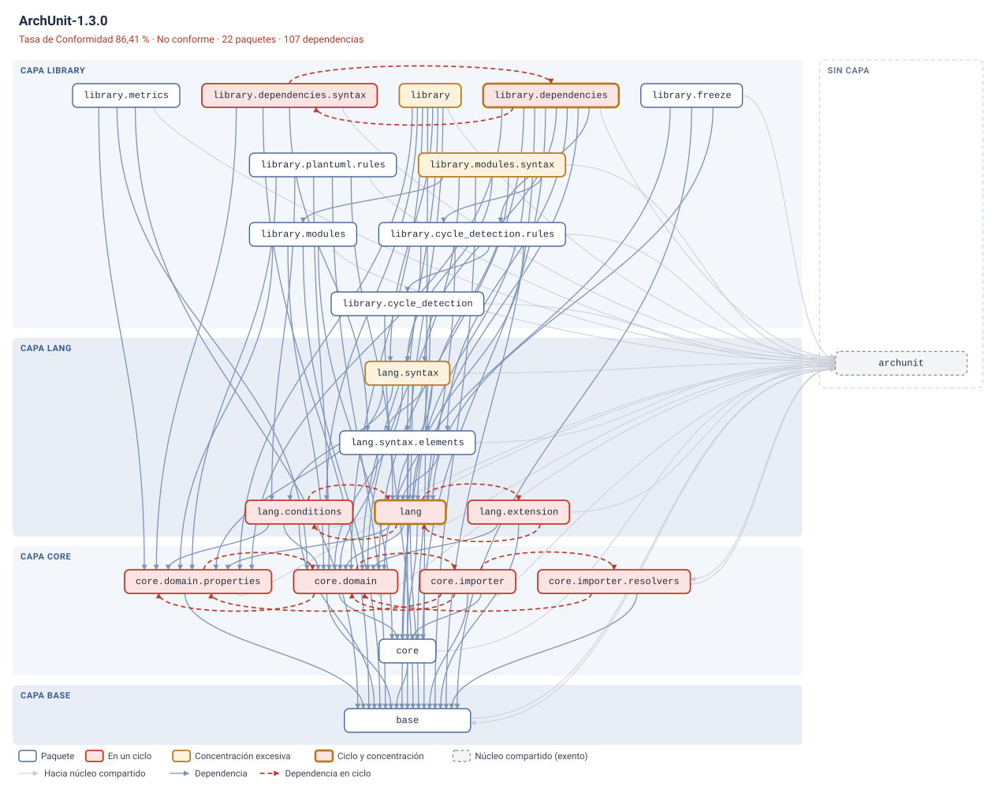

# Arquitecta

Prototipo funcional del mecanismo de detección de deriva arquitectónica descrito
en el proyecto de grado _«Mecanismo de detección automática de deriva
arquitectónica mediante el uso de Fitness Functions y análisis estático de grafos
de dependencia»_ (Maestría en Ingeniería de Software, Pontificia Universidad
Javeriana Cali).

Implementa un flujo de tres etapas: **extracción** de dependencias desde el
código compilado, **construcción** de un grafo estructural y **validación**
mediante _Fitness Functions_, con cálculo de una Tasa de Conformidad (CR) y
clasificación del estado arquitectónico.

---

## Componentes

| Paquete               | Responsabilidad                                                                                                                                                                                                                          |
| --------------------- | ---------------------------------------------------------------------------------------------------------------------------------------------------------------------------------------------------------------------------------------- |
| `…arquitecta.config`  | Catálogo de reglas como configuración: capas, matriz de adyacencias, umbrales y modo de clasificación.                                                                                                                                   |
| `…arquitecta.grafo`   | Grafo de dependencias con evidencia por arista (`GrafoDependencias`), extracción desde bytecode con ArchUnit (`ConstructorGrafo`), componentes fuertemente conexos (`Tarjan`) y reconstrucción de la ruta cíclica (`BuscadorCiclos`).    |
| `…arquitecta.reglas`  | Las tres _Fitness Functions_: integridad de capas, ciclos de dependencia y concentración de dependencias salientes. Cada regla se autodescribe (propiedad, racionalidad, unidad de verificación, criterio de incumplimiento, severidad). |
| `…arquitecta.motor`   | Agrega las verificaciones, calcula la CR y clasifica el estado por CR, por severidad y en su combinación.                                                                                                                                |
| `…arquitecta.reporte` | Reporte textual con declaración de alcance, catálogo ejecutable y exportadores a JSON, CSV y DOT.                                                                                                                                        |
| `…arquitecta.servicio` | Fachada del análisis que comparten la línea de comandos y la interfaz gráfica: reconoce la carpeta de un proyecto Maven, Gradle, IntelliJ o Eclipse (o un `.jar`), carga el catálogo o infiere una configuración mínima y ejecuta el pipeline completo. |
| `…arquitecta.interfaz` | Interfaz gráfica de escritorio (Swing, incluida en el JDK): selección del proyecto, indicadores, grafo interactivo, hallazgos con su evidencia y exportación. Solo presenta: pide el análisis al servicio y dibuja su resultado. |

La arquitectura interna es estrictamente acíclica y estratificada; el propio
mecanismo la verifica (véase _Autoanálisis_, más abajo).

## Requisitos

- **JDK 17 o superior** (verificado con JDK 17 y JDK 26).
- Maven es **opcional**: los scripts usan las dependencias ya empaquetadas en
  `lib/`, por lo que no se requiere conexión a internet ni repositorio local.

## Inicio rápido

```bat
arquitecta.bat   REM abre la interfaz grafica (compila antes si hace falta)
build.bat        REM compila nucleo, pruebas y los cinco escenarios
test.bat         REM ejecuta la bateria de pruebas (190 comprobaciones)
experimento.bat  REM ejecuta el experimento completo y escribe resultados\
figuras.bat      REM regenera los grafos de la monografia y de esta guia
```

En macOS o Linux, los equivalentes son `./arquitecta.sh`, `./build.sh`,
`./test.sh`, `./experimento.sh` y `./figuras.sh`.

Para ver el grafo de cualquier sistema basta con una línea; el resultado se abre
en el navegador, sin instalar nada:

```bat
java -cp "out\arquitecta-core;lib\*" co.javeriana.msw.arquitecta.ArquitectaApp ^
     mi-sistema.jar mis-reglas.properties --svg grafo.svg
```

## Interfaz gráfica

`arquitecta.bat` (o `./arquitecta.sh`) abre la aplicación de escritorio. No
requiere instalar nada más que el JDK: está construida con Swing, que el propio
JDK incluye.


El flujo sigue tres pasos, en la barra lateral:

1. **Proyecto.** _Examinar…_ abre un selector de carpetas; también se puede
   arrastrar la carpeta (o un `.jar`) a la ventana. No hace falta localizar a
   mano el directorio de clases: basta con la carpeta raíz del proyecto, y la
   aplicación reconoce `target/classes` (Maven), `build/classes/java/main`
   (Gradle), `out/production` (IntelliJ IDEA), `bin` (Eclipse) o el `.jar`
   generado. Si la carpeta solo contiene fuentes `.java`, lo indica y pide
   compilar primero, en lugar de devolver un análisis vacío.
2. **Catálogo de reglas.** Si el proyecto trae su catálogo (`rules.properties`,
   `arquitecta.properties`, `reglas.properties` o `.arquitecta.properties`), se
   carga solo. Si no, se aplica una **configuración mínima**: se infiere la raíz
   de paquetes y se evalúan ciclos y concentración; la estratificación no puede
   verificarse sin capas declaradas, y la interfaz lo advierte.
3. **Clasificación.** _Extensión y gravedad_ (recomendado, modo
   `cr+severidad`) o _Solo Tasa de Conformidad_ (modo `cr`).

El resultado muestra la CR (con su variación respecto del análisis anterior del
mismo proyecto, que se conserva en `~/.arquitecta/historial.csv`), el estado, el
tamaño del sistema, los hallazgos y la conformidad por regla, y tres pestañas:

- **Grafo**: la misma disposición por capas que el SVG, con zoom (rueda), arrastre
  y selección. Al hacer clic en un paquete se atenúa todo lo que no le concierne
  y una ficha muestra su capa, `Ce`/`Ca`, de quién depende, quién depende de él
  y los hallazgos en que interviene. _Ampliar grafo_ pliega los indicadores para
  dedicar al grafo toda la altura.
- **Hallazgos**: tabla por severidad; al seleccionar uno se ve su evidencia (las
  llamadas concretas en el código) y se resalta en el grafo.
- **Reporte**: el reporte textual, idéntico al de la línea de comandos.

_Exportar…_ escribe la evidencia completa (reporte, JSON, CSV y el grafo en SVG,
TikZ y DOT) en la carpeta elegida, y _Guardar SVG…_ solo la imagen del grafo.
Atajos: `Ctrl+O` abre un proyecto y `F5` repite el análisis.

La interfaz también se puede abrir con un proyecto ya cargado
(`arquitecta.bat C:\ruta\al\proyecto`) y, para documentación, dibujarse sin
ventana: `--gui --proyecto <ruta> [--reglas <archivo>] --captura salida.png`
(`figuras.bat` genera así las capturas de `ejemplos/interfaz/`).

## Uso manual

```bat
java -cp "out\arquitecta-core;lib\*" co.javeriana.msw.arquitecta.ArquitectaApp ^
     <proyecto | directorio-de-clases | archivo.jar> [archivo-config] [opciones]
```

El sistema puede indicarse como un directorio de clases compiladas, como la
carpeta raíz de un proyecto Maven, Gradle, IntelliJ o Eclipse, o directamente como
el `.jar` con que se distribuye. Si se omite el archivo de configuración, se
aplica la configuración mínima descrita en _Interfaz gráfica_. Si no se encuentra ninguna
clase bajo la raíz declarada, el mecanismo termina con un error: un grafo vacío
obtendría una CR del 100 % y se declararía aceptable, de modo que apuntar por
descuido al directorio de fuentes produciría un falso negativo silencioso.

| Opción                    | Efecto                                                                                                                            |
| ------------------------- | --------------------------------------------------------------------------------------------------------------------------------- |
| `--etiqueta <nombre>`     | Nombra el escenario en el reporte y en los archivos de evidencia.                                                                 |
| `--salida <directorio>`   | Escribe reporte (`.txt`), evidencia estructurada (`.json`), hallazgos (`.csv`), el grafo dibujado (`.svg`, `.tikz`, `.dot`) y agrega una fila a `resumen.csv`. |
| `--svg <archivo>`         | Dibuja el grafo como imagen SVG, que se abre en cualquier navegador.                                                              |
| `--tikz <archivo>`        | Dibuja el grafo como figura TikZ, lista para `\input` en un documento LaTeX.                                                       |
| `--historico <csv>`       | Compara con la última corrida registrada para la misma etiqueta y reporta la variación. Si se omite y hay `--salida`, usa el `resumen.csv` de ese directorio. |
| `--modo cr\|cr+severidad` | Sobrescribe el modo de clasificación declarado en la configuración.                                                               |
| `--fallar-si <estado>`    | Devuelve código de salida 2 si el veredicto alcanza esa gravedad (afordancia para uso futuro en integración continua).            |
| `--catalogo`              | Imprime el catálogo de _Fitness Functions_ derivado de la implementación vigente y termina.                                       |

## Visualización del grafo


El mecanismo dibuja el grafo que extrae, sin depender de Graphviz ni de ninguna
otra herramienta. Lo hace con un algoritmo propio de disposición por capas, por
una razón concreta: los algoritmos genéricos colocan los nodos según el sentido
de las aristas, y justo las violaciones —que remontan la estratificación— pueden
invertir el orden de las capas. Aquí el orden vertical lo dicta la arquitectura
declarada.

- **Bandas por capa**, ordenadas según la matriz de dependencias permitidas, no
  según el orden en que se declararon.
- **Filas** dentro de cada banda por camino más largo, de modo que también las
  dependencias internas apunten hacia abajo; los paquetes de un ciclo comparten fila.
- **Reducción de cruces** por baricentro.
- **Columna lateral** para los paquetes sin capa.

El trazado codifica el significado: las dependencias que remontan las capas
rodean los nodos por fuera; las de una misma fila se dibujan como arcos, por
arriba en un sentido y por abajo en el otro; las flechas que llegan a un mismo
lado se reparten a lo largo de él, y los paquetes muy referenciados se ensanchan.

| Elemento | Significado |
| --- | --- |
| Arista roja continua | Viola la integridad de capas |
| Arista roja discontinua | Forma parte de un ciclo |
| Recuadro rojo | Paquete en un ciclo |
| Recuadro ámbar | Concentración excesiva de dependencias salientes |
| Recuadro gris discontinuo | Núcleo compartido exento |

Cada paquete del SVG tiene un texto emergente con su nombre completo, su capa,
su `Ce`, su `Ca` y su estado. La misma disposición se emite como **TikZ** —las
figuras de grafos de la monografía las genera la herramienta, no se dibujaron a
mano— y como **DOT**, que fija las filas para que tampoco Graphviz pueda invertir
las capas.

`figuras.bat` / `figuras.sh` regenera todas las figuras: las TikZ en
`../Maestria_PlantillaProyectoGrado/figuras/` y las SVG en `ejemplos/graficos/`.

## Configuración

Todo el conocimiento sobre qué es admisible vive en un archivo `.properties`; el
motor no contiene ninguna regla codificada. Véase `rules.properties` para el caso
de estudio y `rules-arquitecta.properties` para el autoanálisis.

```properties
raiz=com.caso
capas=presentacion,negocio,persistencia
capa.presentacion=com.caso.presentacion
capa.negocio=com.caso.negocio
capa.persistencia=com.caso.persistencia
permitido.presentacion=negocio
permitido.negocio=persistencia
permitido.persistencia=
excluir=
rol.compartido=
umbral.concentracion=3
umbral.cr.aceptable=85
umbral.cr.observacion=70
clasificacion.modo=cr+severidad
```

Los paquetes no asignados a ninguna capa (por ejemplo, un dominio compartido)
quedan fuera de la regla de integridad de capas: al no pertenecer a la
estratificación, no puede afirmarse que la vulneren.

> **Orden de declaración.** La asignación de paquetes a capas se resuelve por
> prefijo, en el orden en que las capas aparecen en `capas`. Si una capa es
> prefijo de otra, debe declararse después de la más específica.

### Exenciones

Un catálogo que no admita excepciones obliga a elegir entre tolerar falsos
positivos o apagar la regla entera. Se distinguen dos situaciones, y el reporte
enumera ambas para que la excepción quede registrada y sea auditable.

| Clave            | Para qué                                                                                                         | Alcance                                                  |
| ---------------- | ---------------------------------------------------------------------------------------------------------------- | -------------------------------------------------------- |
| `excluir`        | Código que **no forma parte** del sistema evaluado aunque el empaquetado lo sitúe bajo la misma raíz: dependencias vendorizadas, código generado. Lo saca del grafo. | El paquete **y todos sus subpaquetes**.                   |
| `rol.compartido` | Paquetes que **sí forman parte** del sistema pero cuyo papel —núcleo de anotaciones, raíz de composición, fachada— hace que concentren dependencias por diseño. Quedan exentos de las reglas de ciclos y de concentración, pero siguen en el grafo y en la evidencia. | **Exacto**, no se hereda a los subpaquetes.               |

La asimetría es deliberada. Excluir código ajeno es siempre una cuestión de
subárbol; un papel arquitectónico, en cambio, lo desempeña un paquete concreto, y
propagarlo hacia abajo eximiría al sistema entero cada vez que el núcleo
compartido resultara ser la raíz, que es el caso más frecuente.

### Tendencia

El valor absoluto de la CR padece un efecto de dilución: al ser una proporción,
una violación aislada pesa cada vez menos conforme crece el sistema. Su
**variación** no sufre ese problema, porque se mide contra el propio sistema y no
contra un umbral universal. Conservando el `resumen.csv` entre corridas, el
reporte añade la comparación automáticamente:

```
  Tasa de Conformidad     : 86.41%
  Tendencia               : +4.10 pp respecto de la corrida anterior (82.31%) · mejora
```

## Interpretación del resultado

La CR agrega las verificaciones atómicas de todas las reglas —una por cada arista
entre capas distintas, y una por cada paquete en el caso de ciclos y de
concentración— y se calcula como

```
CR = 100 × (verificaciones − incumplimientos) / verificaciones
```

El mecanismo deriva de ella dos lecturas complementarias y adopta, en el modo
`cr+severidad`, la más restrictiva:

| Criterio            | Qué mide                         | Clasificación                                                                   |
| ------------------- | -------------------------------- | ------------------------------------------------------------------------------- |
| Tasa de Conformidad | **Extensión** del incumplimiento | `CR ≥ 85%` aceptable · `70% ≤ CR < 85%` en observación · `CR < 70%` no conforme |
| Severidad máxima    | **Gravedad** del peor hallazgo   | crítica → no conforme · mayor → en observación · sin hallazgos → aceptable      |

El modo `cr` reproduce la formulación original, basada únicamente en la CR, y se
conserva para poder comparar ambos criterios.

## Escenarios del experimento

`caso-estudio/` contiene la implementación de referencia: un pequeño sistema por
capas (`presentacion`, `negocio`, `persistencia`) con un dominio compartido
(`com.caso.dominio`). Los cuatro escenarios restantes introducen derivas
deliberadas, los tres primeros de forma **aislada** para poder medir la
sensibilidad de cada regla por separado:

| Escenario                       | Deriva inducida                                                                                                                            |
| ------------------------------- | ------------------------------------------------------------------------------------------------------------------------------------------ |
| `caso-estudio-c1-capas`         | Salto de capa `presentacion → persistencia`: el controlador accede al repositorio sin pasar por el servicio. No cierra ciclos.             |
| `caso-estudio-c2-ciclo`         | Ciclo `com.caso.negocio ↔ com.caso.negocio.calculo`, contenido dentro de una misma capa, de modo que la estratificación permanece intacta. |
| `caso-estudio-c3-concentracion` | Paquete `com.caso.util` con `Ce = 4`, sin capa asignada y sin ser destino de nadie: no rompe capas ni cierra ciclos.                       |
| `caso-estudio-c4-combinado`     | Las tres derivas simultáneas: ruptura de capas, ciclo entre tres paquetes y componente dios.                                               |

## Resultados verificados

Salida de `experimento.bat` (idéntica a la comprobada por la batería de pruebas):

| Escenario          | Paquetes | Dependencias | Verificaciones | Incumpl. |       CR | Estado (modo `cr`) | Estado (modo `cr+severidad`) |
| ------------------ | -------: | -----------: | -------------: | -------: | -------: | ------------------ | ---------------------------- |
| C0 · base          |        4 |            5 |             10 |        0 | 100,00 % | Aceptable          | Aceptable                    |
| C1 · capas         |        4 |            6 |             11 |        1 |  90,91 % | Aceptable          | En observación               |
| C2 · ciclo         |        5 |            8 |             12 |        2 |  83,33 % | En observación     | No conforme                  |
| C3 · concentración |        5 |            9 |             12 |        1 |  91,67 % | Aceptable          | En observación               |
| C4 · combinado     |        5 |           11 |             14 |        6 |  57,14 % | No conforme        | No conforme                  |

Las tres derivas se detectan en todos los escenarios. Nótese que en C1 y en C3 la
CR por sí sola clasifica como _aceptable_ un sistema con una violación real: al
ser una proporción no ponderada, diluye los incumplimientos localizados. Incorporar
la severidad corrige esa lectura sin alterar el cálculo de la CR.

## Autoanálisis

El mecanismo se aplica sobre su propio código compilado:

```bat
java -cp "out\arquitecta-core;lib\*" co.javeriana.msw.arquitecta.ArquitectaApp ^
     out\arquitecta-core rules-arquitecta.properties --etiqueta Arquitecta-autoanalisis
```

Resultado: 8 paquetes, 21 dependencias, 33 verificaciones, 0 incumplimientos →
**CR 100 % · Aceptable**. La arquitectura interna del prototipo satisface las
mismas reglas que exige a los sistemas que evalúa.

La configuración declara las capas `servicio` e `interfaz` entre el reporte y la
raíz, y prohíbe a la interfaz el acceso directo a la configuración y a la
extracción: si alguna vez los usara en lugar de pedírselos al servicio, la regla
lo señalaría como deriva. Declara además como núcleo compartido
(`rol.compartido`) la raíz de composición y el servicio, porque dependen de los
módulos que ensamblan por definición del patrón (raíz de composición y fachada),
no por deterioro. Declararlo permite mantener el umbral
estricto en lugar de relajarlo para todo el sistema, que es lo que ocultaría
concentraciones reales en los demás paquetes. Bajándolo a 3 aparecen el módulo de
reporte y la interfaz (`Ce = 4` cada uno), que dependen de los cuatro módulos que
deben representar: el caso
ilustra que el umbral no es universal y que cada sistema obliga a decidir dónde
está su techo razonable.

## Sobre código real: ArchUnit 1.3.0

El mecanismo se aplicó sobre una biblioteca de terceros —923 clases propias en 22
paquetes— declarando como hipótesis la estratificación `base ← core ← lang ←
library`. El análisis completo tarda **1,2 segundos** y se hace directamente
sobre el `.jar`; las configuraciones están en `ejemplos/archunit/`:

```bat
java -cp "out\arquitecta-core;lib\*" co.javeriana.msw.arquitecta.ArquitectaApp ^
     lib\archunit-1.3.0.jar ejemplos\archunit\rules-archunit.properties --svg archunit.svg
```



Las capas aparecen en el orden correcto aunque la configuración las declara de
abajo arriba, porque el orden se deduce de la matriz de dependencias permitidas.

|                          | Sin exenciones | Con exenciones declaradas |
| ------------------------ | -------------: | ------------------------: |
| Paquetes                 |             43 |                        22 |
| Dependencias             |            222 |                       107 |
| Integridad de capas      |          61/61 |                     61/61 |
| Ciclos (mayor)           |    12 incumpl. |  9 incumpl. (7 → 4 paq.)  |
| Concentración            |    14 marcados |                 5 marcados |
| **Tasa de Conformidad**  |      82,31 %   |                  86,41 %  |

ArchUnit empaqueta Guava y ASM bajo su propio prefijo: sin exenciones, casi la
mitad del grafo es código que no le pertenece. Declararlas elimina **9 de los 14**
hallazgos de concentración y reduce el ciclo mayor de 7 paquetes a 4, porque el
paquete de anotaciones al que todo referencia actuaba como puente entre módulos
que entre sí no se alcanzan.

Dos lecturas importan. La primera: la regla de capas dio **61/61 en ambas
configuraciones**, de modo que la hipótesis sobre su arquitectura era correcta y
la regla no produjo un solo falso positivo. La segunda: los tres ciclos
**sobreviven** a las exenciones, que es como debe ser — el objetivo era retirar el
ruido, no silenciar los hallazgos.

## Evidencia generada

`experimento.bat` escribe en `resultados/`:

```
resultados/
├─ catalogo-reglas.txt          catálogo derivado de la implementación
├─ modo-cr/                     un subdirectorio por modo de clasificación
│  ├─ resumen.csv               una fila por escenario
│  ├─ c1-capas.txt              reporte legible
│  ├─ c1-capas.json             evidencia estructurada y completa
│  ├─ c1-capas.svg              grafo dibujado (abrir en el navegador)
│  ├─ c1-capas.tikz             el mismo grafo como figura LaTeX
│  ├─ c1-capas.dot              el mismo grafo para Graphviz
│  └─ c1-capas-hallazgos.csv    una fila por hallazgo
└─ modo-cr-severidad/           idem, con la clasificación refinada
```

Los `.svg` se abren directamente en cualquier navegador. Los `.dot` pueden
procesarse además con Graphviz si se prefiere.

## Pruebas

`test.bat` ejecuta 190 comprobaciones sobre el grafo, el algoritmo de Tarjan, la
carga de configuración, las tres reglas, el motor, las exenciones, los cinco
escenarios, los exportadores, la disposición gráfica, la comparación entre
corridas y el servicio de análisis (reconocimiento de proyectos Maven y Gradle,
paridad entre carpeta y `.jar`, configuración mínima), incluidos los casos
límite (grafo vacío, umbrales en su frontera exacta, configuraciones inválidas,
exenciones que no cuelgan de la raíz). La batería se construyó **sin dependencias
externas**, en coherencia con el requisito de ligereza del propio mecanismo, y
devuelve código de salida distinto de cero si alguna comprobación falla.

## Compilación con Maven

```bat
mvn -q clean package
```

Genera `target/arquitecta.jar` con las dependencias empaquetadas
(`maven-shade-plugin`). Ejecutado sin argumentos (`java -jar target/arquitecta.jar`,
o con doble clic) abre la interfaz gráfica. La batería de pruebas se compila en la fase
`test-compile`, pero se ejecuta mediante `test.bat` / `test.sh`, no por
_surefire_, porque deliberadamente no depende de un marco de pruebas externo.

## Notas

- Al ejecutar con **JDK 26** aparecen avisos benignos en `stderr` (SLF4J sin
  proveedor de _logging_ y una advertencia sobre `sun.misc.Unsafe` emitida por
  Guava, embebida en ArchUnit). No afectan el resultado; con JDK 17 no se
  presentan.
- Los scripts fijan la página de códigos UTF-8 (`chcp 65001`) y la salida se
  emite explícitamente en UTF-8, de modo que los reportes conserven los acentos
  en la consola de Windows.
